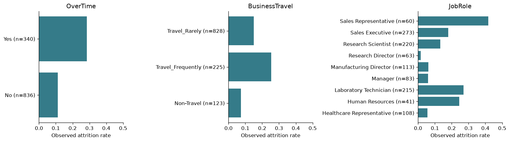

# Data and methodology

[← Back to README](../README.md)

How the data is validated and split, how models are compared and the operating threshold chosen, how predictions are explained, and which training-only diagnostics accompany the frozen model.

## Business problem

Can available employee attributes distinguish observed attrition from retention? Which attributes contribute most to those model predictions? The workflow illustrates how an analyst might study retention-related patterns while recognizing uncertainty, sensitive attributes, and the costs of false positives and false negatives.

## Dataset

The supplied `WA_Fn-UseC_-HR-Employee-Attrition.csv` has 1,470 rows and 35 columns. Its target is `Attrition`: **Yes = 1**, **No = 0**. There are 237 Yes records and 1,233 No records (16.1% versus 83.9%). The [dataset publisher describes it as fictional data created by IBM data scientists](https://www.kaggle.com/datasets/pavansubhasht/ibm-hr-analytics-attrition-dataset). It does not establish real-world HR performance or a prediction horizon.

The canonical dataset is `data/raw/WA_Fn-UseC_-HR-Employee-Attrition.csv`; no root-level CSV is required. Loading validates all 35 columns, target labels, types, bounds, categories, duplicate rows/IDs, and constant assumptions. Missing predictors are reported and imputed within training folds; missing targets or entirely missing predictor columns fail clearly. The provided file contains no missing values or duplicate rows.

| Excluded feature | Reason confirmed on training rows |
|---|---|
| `EmployeeCount` | Constant 1 |
| `Over18` | Constant Y |
| `StandardHours` | Constant 80 |
| `EmployeeNumber` | Unique identifier, without portable predictive meaning |

The remaining 30 predictors are documented in `src/attrition/config.py`. Numeric bounds express broad schema constraints, not fitted dataset extrema. Ordinal ratings are treated numerically; the equal-spacing assumption is a limitation.

## EDA highlights

EDA uses only the 1,176 training rows. The saved tables cover every predictor: category counts/rates, numeric summary statistics by target, missingness, IQR outlier counts, and numerical correlations. Overtime groups show different observed attrition rates; this is an association and does not show that overtime causes a departure. Income, job level, and career tenure variables overlap; a separate training-CV ablation investigates dropping `JobLevel`, `YearsInCurrentRole`, and `YearsWithCurrManager`.

Outliers are inspected rather than automatically trimmed. High income can correspond to senior roles, and IQR flags on bounded ratings are not evidence of data errors. No correlated variables are removed from the main candidates without a prespecified comparison.

## Modeling approach and evaluation

The fixed split and all applicable estimators use seed **42**. Five shuffled stratified folds compare a prior-based `DummyClassifier`, unweighted and balanced logistic regression, a constrained balanced random forest, and regularized histogram gradient boosting. No SMOTE or XGBoost dependency is required.

The primary comparison is **average precision (AP)**, labeled `pr_auc` in JSON. AP is a weighted summary of precision over recall increments, not trapezoidal area under the PR curve. Precision, positive-class recall, F1, ROC-AUC, confusion counts, and Brier score are also recorded. CV reports means and population standard deviations for AP, ROC-AUC, precision, recall, and F1. Accuracy is not a selection criterion.

The prespecified selection rule chooses the highest training CV AP, preferring unweighted logistic regression, then balanced logistic regression, if within 0.01 AP of the best candidate. This makes the interpretability/complexity tradeoff explicit. The diagnostic sensitive/correlated-feature ablations do not become additional candidates. Test results never change the rule.

## Evaluation boundaries

| Stage | Data available | Purpose and limits |
|---|---|---|
| Split and exploration | Structural validation of the raw data; EDA on the 80% training partition only | A seeded, stratified 20% holdout is reserved before exploration or fitting. Schema checks do not learn preprocessing statistics. |
| Ordinary CV | Five folds within training | Compare fixed candidates by mean AP. Each fold fits normalization, imputation, scaling, encoding, and the estimator together in a pipeline. The chosen candidate's CV score reuses the selection folds and can be optimistic. |
| Model and OOF threshold selection | Training CV summaries and training OOF predictions only | Freeze the model by the prespecified AP rule, then maximize OOF F2. These threshold scores are selection diagnostics, not an independent performance estimate. |
| Nested CV | Outer and inner folds entirely within training | Repeat candidate comparison, optional grid tuning, and OOF threshold choice inside each outer training fold. Score the frozen result on that fold's outer validation rows. This assesses the selection procedure, including its threshold rule. |
| Calibration, stability, and feature ablations | Training rows only | Calibration uses inner folds inside outer training folds; stability repeats training CV. Sensitive, correlated, and engineered-feature ablations use training CV and remain outside the candidate set. None updates the served model. |
| Optional AutoML search (`attrition.models.automl`) | Stratified CV folds of the training partition only | Seeded Optuna search proposes a model family and hyperparameters by mean CV AP, with preprocessing refitted in each fold. The best trial's CV AP is optimistic because the same folds chose it. No final model, threshold, holdout score, or served-model change. See [Development](development.md#optional-automl-search-optuna). |
| Final held-out evaluation | Reserved holdout, after all choices are frozen | Evaluate the selected model at its OOF threshold and report sampling uncertainty. The fitted serving pipeline uses only training rows. |

In [the training orchestration](../src/attrition/models/train.py), prepare_data creates the split and training-only exploration. compare_models, choose_operating_point, and training_diagnostics accept explicit training features and labels, rather than the Partitions object containing the holdout. evaluate_holdout runs after these stages; its results go to reporting and never return to selectors or tuners. Synthetic regression tests in [test_evaluation_boundaries.py](../tests/test_evaluation_boundaries.py) check this order, prohibit early holdout access, trace preprocessing fits, and check the exact outer-training rows supplied to tuning and threshold selection.

The holdout is **not evaluated strictly once**. The holdout_at_0_5 JSON field, model_comparison.csv, the README/results tables, and the dashboard's comparison curves retain all five candidates for compatibility. Non-selected comparisons are **post-selection descriptive diagnostics**. The selected model is also scored at its frozen OOF threshold. Bootstrap intervals, subgroup and capacity summaries, and permutation importance reuse holdout labels; optional SHAP explains holdout predictions using a training background. These outputs must never select a model, feature set, hyperparameter, calibration method, or threshold.

These checks enforce the current workflow's data flow, not a security sandbox against arbitrary Python code or deliberately mislabeled inputs. The published holdout has already been examined and is not a fresh independent benchmark for future iterations. Future model development must use training-only evaluation; confirming generalization after repeated development requires new independent data.

## Threshold selection

The selected model generates training out-of-fold probabilities with the same five stratified folds. A grid from 0.05 through 0.95 includes all requested 0.20–0.50 operating points. The selected threshold maximizes **F2**, breaking ties by precision and then the higher threshold. [threshold_analysis.csv](../reports/metrics/threshold_analysis.csv) includes precision, recall, F1/F2, false positives, and false negatives for every point.

F2 expresses an educational preference for recall; it is not an estimated dollar cost. A missed support opportunity could matter more than an unnecessary outreach, but that needs an agreed intervention policy and capacity constraints. A lower threshold increases the number of flagged records. The API and dashboard use the threshold bundled with the model, rather than defaulting to 0.50.

OOF threshold scores reuse the training folds used for model selection and can be optimistic. Final holdout metrics are reported separately, with 95% stratified bootstrap intervals for the selected model ([holdout_bootstrap_ci.csv](../reports/metrics/holdout_bootstrap_ci.csv)). These intervals cover holdout sampling only, not split or selection variability. The saved pipeline remains fitted only on the training partition, preserving correspondence between the evaluated model and deployed demo.

## Explainability

The report includes human-readable logistic coefficients, random-forest impurity importance, and original-feature permutation importance measured as holdout AP decrease over ten shuffles. Numeric logistic coefficients represent a one-training-standard-deviation change; categorical coefficients act on encoded indicators. Full one-hot encoding and correlated predictors require cautious interpretation of individual coefficients.

Optional SHAP generates global importance, a beeswarm summary, and a waterfall for the first holdout record. Logistic SHAP contributions are in **log-odds**, not additive probability points; applying the logistic function to base value plus contributions recovers the model probability. SHAP uses a training background and at most 60 holdout examples. The dashboard also explains the submitted profile using the active bundle's training background, aggregates one-hot contributions to original fields, and displays the ten largest contributions plus the sum of remaining contributions. Tree explanations explicitly use probability units and are checked without a sigmoid transformation.

These explanations describe associations contributing to model predictions. Correlated features can share or mask importance. SHAP failure is isolated and recorded in the report; the core workflow retains coefficient and permutation explanations.

## Training diagnostics and profile explanations

Calibration remains **diagnostic only**. Five outer folds on the training partition compare the selected estimator with and without sigmoid calibration. The calibrated arm uses three inner folds, with normalization, imputation, encoding, and scaling fitted inside each fold. The candidate identity was selected on training CV, so these conditional diagnostics are not an unbiased estimate of the complete selection procedure. Neither calibration nor the additional diagnostics changes the served pipeline or its F2 threshold.

- `calibration_metrics.csv`: outer-OOF Brier score and log loss; lower is better.
- `calibration_bins.csv` and `calibration_reliability.png`: ten equal-width probability bins; empty bins retain zero counts and missing means.
- `stability_comparison.csv` and `stability_selections.csv`: five-fold training CV for seeds 42, 43, and 44, including selected-model frequency and threshold variation. Seed 42 remains the main experiment. This does not measure sensitivity to the reserved holdout split.
- `capacity_metrics.csv`: precision, recall, lift, and counts for the highest-scored 5%, 10%, and 20%; counts round up and score ties preserve row order. Training OOF and final holdout are reported separately.
- `nested_cv_folds.csv`: nested cross-validation on the training partition. Each of five outer folds re-runs the complete selection procedure (candidate comparison, the prefer-logistic rule, and the F2 threshold) on its training rows and scores the result once on the outer fold. The `fixed` procedure is the one actually served; `tuned` also searches small grids chosen in advance (logistic `C`, forest depth and leaf size, boosting learning rate and leaf count) in three inner folds. This estimates the whole procedure rather than the already-selected model, and shows whether tuning would help. It never changes the served model.
- Engineered-feature ablation (`feature_engineering_ablation` in the JSON, `logistic_engineered_features` in `cv_fold_metrics.csv`): five fixed formulas (income per job level, share of career at the company, years per prior employer, share of tenure since the last promotion, and mean satisfaction) are added to the logistic model on the same training folds. The adoption rule was written before running it: at least +0.01 CV AP and higher AP in at least four of five folds. Even when met, the features would need validation on data not used for these choices, so the served model does not use them.

The prediction form explains the profile just submitted. Contributions describe the model output, not causal effects. Logistic contributions add in log-odds; tree contributions add in probability units. Optional SHAP failure leaves the prediction available. Install `requirements-explain.txt` to enable this feature; the default container omits SHAP.

## Limitations and future improvements

This is a small fictional, cross-sectional dataset with no temporal validation or guaranteed feature availability before an attrition event. The structural leakage safeguards do not prove absence of real-world look-ahead bias. Only one holdout split is used; CV variability is reported, and holdout metrics can fluctuate. Scores are uncalibrated probability estimates, particularly for class-weighted models. Ordinal spacing and broad schema bounds are modeling assumptions.

Future work includes independently validated serving calibration, formal fairness metrics, temporal/external validation, scheduled drift monitoring on governed inference traffic, MLflow experiment tracking, DVC data versioning, governed cloud deployment, privacy-preserving database-backed inference logging, and monitored scheduled retraining. These require evidence and a defined operating purpose before adding infrastructure.
